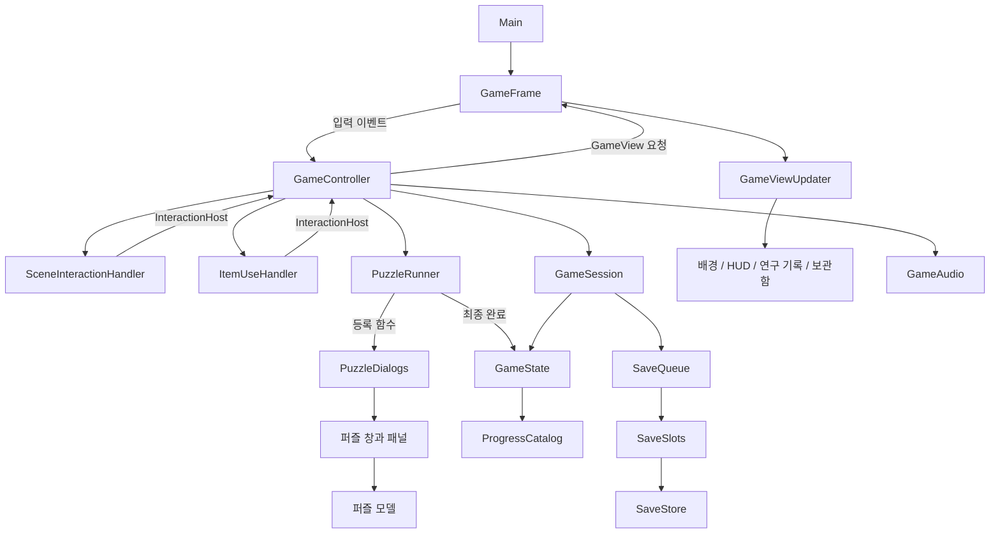

# 진행 데이터 관리

기준: 2026-11-26 작업 트리 / v99. [실제 초반 흐름](OPENING_TIMELINE.md), [미니게임 제작](MINIGAME_TEAM_GUIDE.md).
이 문서의 소스 경로는 저장소 루트 기준입니다.

## 구성과 책임

| 위치 | 책임 |
|---|---|
| src/assets/progression/game.properties | 방·아이템·미션·단계의 고유 ID, 의존 조건, 보상 |
| ProgressCatalog | 정의 읽기 및 참조·스키마 검증 |
| GameState | 완료, 아이템, 미확인 표시, 환경 상태, 방 개방과 이동 |
| GameFrame / GameView | 창 구성, UI 표시와 화면 전환 / 화면 요청 인터페이스 |
| GameController | 시작/종료, 처리기 연결, 공통 완료 콜백과 세션 호출 |
| GameSession | 현재 진행 소유, 새 게임, 비동기 저장과 준비된 저장 적용 |
| SceneInteractionHandler / ItemUseHandler | 배경 클릭 / 보관함 아이템 사용 |
| InteractionHost | 처리기가 사용하는 상태/연출/저장 인터페이스, GameController가 구현 |
| GameViewUpdater | 배경, HUD, 목표, 보관함 갱신 |
| PuzzleDialogs | kind에 따른 미니게임 창 등록 |
| PuzzleRunner | 실행 가능 여부, 중복 실행, 취소·완료와 세션 수명 관리 |
| SaveQueue / SaveStore | 비동기 저장과 복원 |

관리표 XLSX를 자동으로 읽는 기능은 없습니다. 확정된 기획은 game.properties에 반영합니다.

## ID와 선행 조건

ID는 배포 후 다른 의미로 재사용하지 않습니다. `order`는 표시·선택 순서이며 선행 조건을 대신하지 않습니다.
`requires`에 여러 ID가 있으면 모두 완료해야 합니다.
v93은 ACT_GET_CIPHER에서 CIPHER_TABLE을 지급하고 PZ006은 해독표를 보유한 상태에서 PC로 실행합니다. v94에서 M_USB는 PZ021 분석 완료를 기준으로 하고, M_DEVICE와 PZ008은 PZ021을 요구합니다. 따라서 로그 확보 → 분석 → 수리 순서이며 `GATE001.requires=PZ007,PZ011`이 과거 개방 조건입니다.
첫 사고 `ACT_START_FAILURE`는 현재에 남는 사건입니다. 취소된 `ACT_FIRST_TRAVEL`은 저장 호환을 위해 남지만 새 실행은 차단됩니다.

| 필드 | 의미 |
|---|---|
| order / name | 정렬 값과 표시 이름 |
| room / mission / object | 소속 방·미션·상호작용 오브젝트 |
| kind | log_analysis, present, rush_hour, gears, wires, temporary_power, confirm, action 등의 구현 종류 |
| requires / items | 완료 단계 조건 / 보유 아이템 조건 |
| consume / grant | 완료 시 아이템 소비 / 지급 |
| flags / unlock | 환경 상태 기록 / 방 개방 |
| automatic | 조건 충족 시 모델에서 자동 처리. collection과 gate 등에 사용 |
| prompt / itemPrompt | 다음 행동 / 부족한 아이템 안내 |

소비 아이템은 items에도 선언합니다. 완료 ID의 재처리로 보상을 중복 지급하지 않습니다.
현재 배전함 `PZ004`는 wires, 과거 `PZ002`는 gears, 미래 `PZ003`은 temporary_power입니다.
모델을 재사용하는 ID와 실제 완료 단계 ID를 구분합니다.

## 퍼즐과 방 확장

1. steps 목록과 고유 단계 정의를 추가합니다.
2. 새로운 구현은 모델·패널·창으로 분리하고 `PuzzleDialogs.launchers()`에 등록합니다.
3. 최종 완료만 SOLVED로 반환합니다. 패널에서 아이템 지급이나 저장을 직접 호출하지 않습니다.
4. 미션 완료 기준과 후속 단계 requires를 함께 검토합니다. 순서 번호만 바꾸어 필수 단계를 삽입할 수는 없습니다.
5. 새 클릭 영역은 HotspotCatalog, 아이템 그림·설명과 사용 처리는 해당 UI에 연결합니다.
6. 새 방은 rooms와 era/title/exits를 정의하고 unlock으로 개방합니다. 실제 이동은 enterRoom이 현재 방의 exits와 개방 여부를 검사합니다.

설정에 새 방을 적는 것만으로 고유 배경이나 이동 UI가 생성되지는 않습니다.
현재 기본 연결은 현재→과거→미래이며, 양방향 재방문과 숨겨진 방은 별도 구현·검증이 필요합니다.

## 저장과 완료 처리

Snapshot은 schemaVersion, roomId, completed, items, flags, unlockedRooms, unreadItems를 담는 불변 복사본입니다.
미완료 퍼즐의 세부 배치는 저장하지 않습니다. 상세 위치·복구 정책은 [저장 안내](SAVE_GUIDE.md)를 참고하세요.
새 게임은 `GameState.newGame()`을 사용합니다. 일반 생성자는 예전 진행과 저장 복원의 기준이므로 용도를 혼동하지 않습니다.
Rush Hour의 지연 완료는 `CompletionReservation`으로 취소·초기화·창 종료 후 콜백을 차단합니다.

현재 검증과 정답 데이터는 [테스트 안내](../test/README.md)에 있습니다.

## USB 사고 분석 PZ021

AccidentLogPuzzle은 세션 내 순서와 선택만 보유하고 AccidentLogPanel은 공통 RepairPuzzleDialog를 사용합니다. PC 또는 보관함 USB에서 시작합니다. 1단계 완료/치트는 2단계로만 전환하며, 최종 완료만 PuzzleRunner를 통해 보상 FAULT_REPORT와 자동저장을 처리합니다. 중간에 닫으면 다음 실행에서 처음부터 시작합니다. 저장 스키마는 2를 유지합니다. 이미 PZ008을 완료한 이전 저장은 수리 미션 잠금을 예외 처리하여 진행을 유지하고, 새 보상을 소급 지급하지 않습니다.

## v99 최종 흐름

실선은 호출 또는 소유 관계입니다. Frame은 조립 시 컨트롤러와 의존성을 생성하지만 진행 상태를 필드로 보관하거나 변경하지 않습니다.

화면 갱신 요청 뒤 자동저장을 요청하는 기존 순서를 유지합니다. 퍼즐 창은 SOLVED/CANCELLED를 반환하며, 보상 적용은 PuzzleRunner→GameState에서 한 번만 처리합니다. 로드는 GameSession.prepareLoad → GameView.prepareGameView → GameSession.applyLoaded → 화면 복원/갱신 순서입니다. 종료는 진행 저장 → 음량 저장 → 세션/오디오 종료 → 창 닫기 순서입니다.

## 전체 Java 파일별 역할 (v99)

범위: src/timeescape의 제품 소스. test, tools의 검증/제작 코드는 제외합니다. 인터페이스와 열거형도 별도 파일로 포함합니다.

| 파일 | 역할 |
|---|---|
| [core/CompletionReservation.java](../src/timeescape/core/CompletionReservation.java) | Rush Hour 등의 지연 완료 예약과 취소 처리 |
| [core/GameSession.java](../src/timeescape/core/GameSession.java) | 현재 GameState, 새 게임, 저장 대기열과 불러온 상태 적용 수명 관리 |
| [core/GameState.java](../src/timeescape/core/GameState.java) | 완료 ID, 아이템, 미확인 표시, 환경 플래그, 열린 방과 진행 조건 |
| [core/ProgressCatalog.java](../src/timeescape/core/ProgressCatalog.java) | game.properties에서 진행 정의를 읽고 참조 관계 검증 |
| [core/TimeTravelController.java](../src/timeescape/core/TimeTravelController.java) | 손목 장치의 이동 가능 여부, 목적지 표시와 시대 이동 실행 |
| [Main.java](../src/timeescape/Main.java) | Swing 스레드에서 폰트와 메인 창을 초기화하는 진입점 |
| [model/Era.java](../src/timeescape/model/Era.java) | 현재/과거/미래 시점을 표현하는 열거형 |
| [puzzle/AccidentLogPuzzle.java](../src/timeescape/puzzle/AccidentLogPuzzle.java) | 기록 순서, 최초 이상 선택과 두 단계 정답 판정 |
| [puzzle/FileRushHourModel.java](../src/timeescape/puzzle/FileRushHourModel.java) | Rush Hour 블록 배치, 이동 가능 여부와 해결 판정 |
| [puzzle/present/ArchiveCodePuzzle.java](../src/timeescape/puzzle/present/ArchiveCodePuzzle.java) | 문양에 대응하는 PC 암호 정답 규칙 |
| [puzzle/present/CyclicValuesPuzzle.java](../src/timeescape/puzzle/present/CyclicValuesPuzzle.java) | 순환 값 조작을 사용하는 퍼즐의 공통 모델 |
| [puzzle/present/ModuleAssemblyPuzzle.java](../src/timeescape/puzzle/present/ModuleAssemblyPuzzle.java) | 장치 모듈 조립 규칙 |
| [puzzle/present/PowerDistributionPuzzle.java](../src/timeescape/puzzle/present/PowerDistributionPuzzle.java) | 전력 합계 퍼즐 규칙. 현재 미래의 임시 퍼즐에서 사용 |
| [puzzle/present/PresentPuzzle.java](../src/timeescape/puzzle/present/PresentPuzzle.java) | 현재 퍼즐 모델이 제공할 규칙과 표시 정보 인터페이스 |
| [puzzle/present/PresentPuzzles.java](../src/timeescape/puzzle/present/PresentPuzzles.java) | 진행 ID에 맞는 현재 퍼즐 모델 생성 |
| [puzzle/present/SchematicPuzzle.java](../src/timeescape/puzzle/present/SchematicPuzzle.java) | 설계도 조각 회전과 연결 판정 |
| [puzzle/present/TimeCoordinatesPuzzle.java](../src/timeescape/puzzle/present/TimeCoordinatesPuzzle.java) | 시간 좌표 보정 규칙 |
| [puzzle/PresentPuzzleModel.java](../src/timeescape/puzzle/PresentPuzzleModel.java) | 분리된 현재 퍼즐 모델에 위임하는 기존 호출 호환 클래스 |
| [puzzle/PuzzleResult.java](../src/timeescape/puzzle/PuzzleResult.java) | SOLVED 또는 CANCELLED 결과 표현 |
| [puzzle/PuzzleRunner.java](../src/timeescape/puzzle/PuzzleRunner.java) | 조건 확인, 중복 실행 방지, 취소/최종 완료와 세션 검증 |
| [puzzle/RepairModels.java](../src/timeescape/puzzle/RepairModels.java) | Gears/Wires 모델을 포함하며 기어 배치와 배선 연결 규칙 관리 |
| [scene/Hotspot.java](../src/timeescape/scene/Hotspot.java) | 배경 오브젝트의 ID와 클릭 영역 정보 |
| [scene/HotspotCatalog.java](../src/timeescape/scene/HotspotCatalog.java) | 시대별 오브젝트 클릭 영역 정의 |
| [scene/InteractionHint.java](../src/timeescape/scene/InteractionHint.java) | 진행 상태에 따른 현재/이후/완료 오브젝트 강조 분류 |
| [system/AudioSettings.java](../src/timeescape/system/AudioSettings.java) | 음량 값과 별도 설정 파일의 영속 저장 |
| [system/DeveloperMode.java](../src/timeescape/system/DeveloperMode.java) | 개발용 퍼즐 스킵 활성화와 키 바인딩 |
| [system/DialogueCatalog.java](../src/timeescape/system/DialogueCatalog.java) | 외부 대사 파일 읽기와 장면별 문장 조회 |
| [system/GameAudio.java](../src/timeescape/system/GameAudio.java) | 비동기 오디오 초기화, 재생, 음량과 연출 타이밍 |
| [system/ImageAssets.java](../src/timeescape/system/ImageAssets.java) | 게임 이미지 리소스 로딩과 재사용 |
| [system/MenuImageAssets.java](../src/timeescape/system/MenuImageAssets.java) | 시작 화면 이미지 로딩과 캐싱 |
| [system/PowerRestoration.java](../src/timeescape/system/PowerRestoration.java) | 전력 복구 시 깜빡임과 점차 밝아지는 조명 곡선 |
| [system/PuzzleSkipChord.java](../src/timeescape/system/PuzzleSkipChord.java) | Shift+8+9+0 조합 감지와 중복 입력 방지 |
| [system/SaveQueue.java](../src/timeescape/system/SaveQueue.java) | 단일 작업자에서 저장/로드 실행 후 EDT로 결과 전달 |
| [system/SaveSlots.java](../src/timeescape/system/SaveSlots.java) | 자동저장과 수동 4개 저장소, 목록과 요약 관리 |
| [system/SaveStore.java](../src/timeescape/system/SaveStore.java) | 파일 읽기/쓰기, 스키마/체크섬 검증과 백업 복구 |
| [system/ScaledBackground.java](../src/timeescape/system/ScaledBackground.java) | 크기 변경된 배경 이미지를 캐시해 반복 확대 비용 감소 |
| [system/ShiftGlint.java](../src/timeescape/system/ShiftGlint.java) | Shift 상호작용 강조용 빛 스프라이트 |
| [ui/AccidentLogPanel.java](../src/timeescape/ui/AccidentLogPanel.java) | 사고 기록 정렬과 정상/실패 로그 대조 화면 |
| [ui/ArchiveLoginPanel.java](../src/timeescape/ui/ArchiveLoginPanel.java) | PC 암호 입력과 해독표 참조 화면 |
| [ui/AudioSettingsPanel.java](../src/timeescape/ui/AudioSettingsPanel.java) | 배경음악/환경음/효과음 음량 슬라이더 |
| [ui/CipherMemoOverlay.java](../src/timeescape/ui/CipherMemoOverlay.java) | 메모 해독표 이미지 확대 열람 |
| [ui/ClockGlassEffect.java](../src/timeescape/ui/ClockGlassEffect.java) | 시계 유리 균열 이미지와 확산 마스크 연출 |
| [ui/ComputerPuzzleDialog.java](../src/timeescape/ui/ComputerPuzzleDialog.java) | Rush Hour 조작 화면과 지연 완료 연결 |
| [ui/DeviceDialog.java](../src/timeescape/ui/DeviceDialog.java) | 손목 장치 상태와 사용/수리/이동 UI |
| [ui/DialogueOverlay.java](../src/timeescape/ui/DialogueOverlay.java) | 대화창, 글자 순차 표시와 입력음 연출 |
| [ui/FirstTravelOverlay.java](../src/timeescape/ui/FirstTravelOverlay.java) | 초반 장치 실패와 정전 연출. 이름은 과거 구현에서 유지 |
| [ui/GameController.java](../src/timeescape/ui/GameController.java) | 게임 시작/종료, 상호작용, 퍼즐 완료, 화면 갱신과 저장 요청 순서 조정 |
| [ui/GameCursors.java](../src/timeescape/ui/GameCursors.java) | 기본/상호작용 마우스 커서 구성 |
| [ui/GameFonts.java](../src/timeescape/ui/GameFonts.java) | 제목/본문/버튼용 번들 폰트 로딩과 역할별 제공 |
| [ui/GameFrame.java](../src/timeescape/ui/GameFrame.java) | GameView 구현. 창 구성, UI 생성, 화면 전환과 대화창 표시 |
| [ui/GameHud.java](../src/timeescape/ui/GameHud.java) | 상단 바와 노트/메뉴/대사/알림 등 겹침 UI 배치 및 입력 차단 |
| [ui/GameMenuOverlay.java](../src/timeescape/ui/GameMenuOverlay.java) | 게임 메뉴, 저장/불러오기, 설정 등 중앙 오버레이 구성 |
| [ui/GamePreparation.java](../src/timeescape/ui/GamePreparation.java) | UI 생성 전에 이미지, 날씨와 대사 리소스를 비동기로 준비 |
| [ui/GameScenePanel.java](../src/timeescape/ui/GameScenePanel.java) | 시대별 배경, 오브젝트 입력, 조명과 날씨 및 Shift 강조 |
| [ui/GameView.java](../src/timeescape/ui/GameView.java) | 컨트롤러가 요청할 화면 동작을 정의하는 인터페이스 |
| [ui/GameViewUpdater.java](../src/timeescape/ui/GameViewUpdater.java) | 배경 시대/전원/강조, 위치, 연구 기록과 보관함 갱신 |
| [ui/GearBoardRenderer.java](../src/timeescape/ui/GearBoardRenderer.java) | 톱니바퀴 보드와 부품 그리기 |
| [ui/GearsPuzzlePanel.java](../src/timeescape/ui/GearsPuzzlePanel.java) | 톱니바퀴 퍼즐 입력과 완료 처리 |
| [ui/HelpContent.java](../src/timeescape/ui/HelpContent.java) | 조작 도움말 문구와 레이아웃 |
| [ui/InteractionHost.java](../src/timeescape/ui/InteractionHost.java) | 아이템/배경 처리기가 사용할 상태와 부수 효과의 인터페이스. GameController가 구현 |
| [ui/InventoryPanel.java](../src/timeescape/ui/InventoryPanel.java) | 보유 아이템, 설명, 미확인 빨간 점과 사용 콜백 |
| [ui/ItemAcquisitionToast.java](../src/timeescape/ui/ItemAcquisitionToast.java) | 새 아이템 이름과 그림을 보여주는 획득 알림 |
| [ui/ItemUseHandler.java](../src/timeescape/ui/ItemUseHandler.java) | 보관함 아이템 사용, 장치 수리/이동 후속 처리와 지연 콜백 검증 |
| [ui/LabTheme.java](../src/timeescape/ui/LabTheme.java) | 미니게임 공통 색상, 그리기와 컨트롤 스타일 도우미 |
| [ui/LabWindowMask.java](../src/timeescape/ui/LabWindowMask.java) | 실내 오브젝트와 창틀을 제외할 창문 마스크 |
| [ui/LabWindowWeather.java](../src/timeescape/ui/LabWindowWeather.java) | 연구실 창문의 비와 번개 연출 |
| [ui/MainMenuPanel.java](../src/timeescape/ui/MainMenuPanel.java) | 시작/이어하기/설정/종료 메뉴와 시작 연출 진행 |
| [ui/MenuAtmosphere.java](../src/timeescape/ui/MenuAtmosphere.java) | 시작 화면의 배경, 조명, 시계와 날씨 레이어 합성 |
| [ui/MenuStartTimeline.java](../src/timeescape/ui/MenuStartTimeline.java) | 시작 연출의 소등/균열 타이밍 정의 |
| [ui/MissionPanel.java](../src/timeescape/ui/MissionPanel.java) | 현재 행동 목표와 미션 진행 표시 |
| [ui/NotebookScale.java](../src/timeescape/ui/NotebookScale.java) | 노트 내부 폰트와 간격의 비율별 크기 조절 |
| [ui/NotebookStyle.java](../src/timeescape/ui/NotebookStyle.java) | 노트 종이 질감과 글자/버튼 공통 스타일 |
| [ui/PresentPuzzleDialog.java](../src/timeescape/ui/PresentPuzzleDialog.java) | 현재 퍼즐과 PC 암호 입력 화면을 여는 창 |
| [ui/PresentPuzzlePanel.java](../src/timeescape/ui/PresentPuzzlePanel.java) | 설계도/조립/좌표/전력 모델의 입력과 화면 |
| [ui/PuzzleChrome.java](../src/timeescape/ui/PuzzleChrome.java) | 미니게임 공통 테두리, 제목, 버튼과 종료 단축키 스타일 |
| [ui/PuzzleDialogs.java](../src/timeescape/ui/PuzzleDialogs.java) | 진행 데이터의 kind를 실제 퍼즐 창 실행 함수로 연결 |
| [ui/RepairPuzzleDialog.java](../src/timeescape/ui/RepairPuzzleDialog.java) | 배선/톱니바퀴/로그 분석의 공통 창과 결과 반환 |
| [ui/RepairPuzzlePanel.java](../src/timeescape/ui/RepairPuzzlePanel.java) | 공통 제목/설명/버튼 배치, 완료/종료와 단계 스킵 기반 클래스 |
| [ui/SceneInteractionHandler.java](../src/timeescape/ui/SceneInteractionHandler.java) | 배경 클릭, 튜토리얼 상자, 메모, 아이템 수집과 퍼즐 실행 조건 처리 |
| [ui/SceneViewport.java](../src/timeescape/ui/SceneViewport.java) | 배경과 연출에서 공유하는 비율 유지 좌표 계산 |
| [ui/TextureRain.java](../src/timeescape/ui/TextureRain.java) | 기존 유리 하이라이트를 따라 흐르는 빗방울 질감 연출 |
| [ui/TurningNotebook.java](../src/timeescape/ui/TurningNotebook.java) | 노트 표시, 전체 페이지 넘김과 캡처 |
| [ui/WireBoardRenderer.java](../src/timeescape/ui/WireBoardRenderer.java) | 배선 보드, 장애물, 단자와 연결선 그리기 |
| [ui/WiresPuzzlePanel.java](../src/timeescape/ui/WiresPuzzlePanel.java) | 배선 퍼즐 입력과 쉬움/어려움 단계 진행 |
